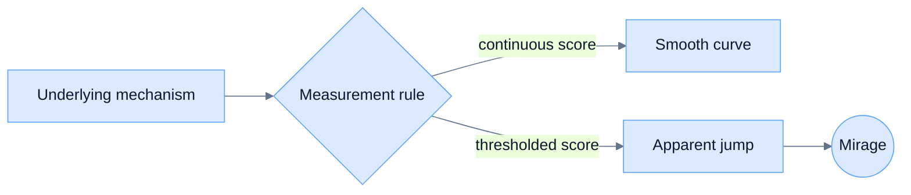

# Interactive HTML Explainer Skill

**Doc link:** <https://github.com/brando90/agents-config/blob/main/writing/explanations/interactive-html-explainer.md>

**TLDR:** Reusable skill for building a single-file interactive HTML explainer with Mermaid diagrams, KaTeX equations and D3 visualizations. Use it when Brando asks for a polished teaching artifact, not paper prose or a publication-ready web app.

## When to use this skill

Use this when the user asks for an interactive explainer, concept demo, teaching page, or standalone HTML document that should combine:

- **Mermaid** for flowcharts, causal diagrams, state machines, or process diagrams.
- **KaTeX** for readable mathematical notation and equations.
- **D3** (Data-Driven Documents) for custom interactive charts or visual simulations.

Typical prompts:

> Use Mermaid, KaTeX, and D3 to make an HTML document explaining `<concept>`.

> Turn this explanation into an interactive standalone page.

> Make a visual concept demo with a diagram, equations, and a slider chart.

Do not use this as the default for research-paper prose, posters, slide decks, or production websites. For teaching style, compose with `~/agents-config/writing/explanations/technical-explainer-style.md`.

## Deliverable

Produce one self-contained `.html` file unless the user requests a project directory.

The file should contain:

1. A clear title and one-paragraph reader-facing summary.
2. A Mermaid diagram that explains structure or flow.
3. A KaTeX-rendered equation section with every symbol glossed in prose.
4. A D3 interactive visualization, usually with a slider or small control.
5. A bottom summary that restates the concept in plain language.

If internet access is acceptable, use content delivery network links for Mermaid, KaTeX, and D3. If the user asks for offline portability, vendor the assets locally or explain what still depends on the network.

## Reader-facing accuracy comes first

Before polishing visuals, make sure the concept is correct.

Workflow:

1. Identify the exact concept and disambiguate similar meanings. For example, the mirage effect in large language models is about metric-induced false emergence, not ordinary hallucination or prompt brittleness.
2. Write the explanation spine in 3-5 claims: what it is, what causes it, how to see it, what the equation means, and how to test it.
3. Choose the visualization that matches the causal story. Do not make a generic chart if the concept demands a specific mechanism.
4. Only then style the page.

If the reviewer says the concept is wrong, rewrite the conceptual spine first; do not merely beautify the existing page.

## HTML scaffold

Start from this shape:

```html
<!doctype html>
<html lang="en">
<head>
  <meta charset="utf-8" />
  <meta name="viewport" content="width=device-width, initial-scale=1" />
  <title>Concept Explainer</title>

  <script src="https://cdn.jsdelivr.net/npm/mermaid@10/dist/mermaid.min.js"></script>
  <link rel="stylesheet" href="https://cdn.jsdelivr.net/npm/katex@0.16.9/dist/katex.min.css" />
  <script defer src="https://cdn.jsdelivr.net/npm/katex@0.16.9/dist/katex.min.js"></script>
  <script defer src="https://cdn.jsdelivr.net/npm/katex@0.16.9/dist/contrib/auto-render.min.js"></script>
  <script src="https://cdn.jsdelivr.net/npm/d3@7"></script>
</head>
<body>
  <header>...</header>
  <main>...</main>
  <script>
    mermaid.initialize({ startOnLoad: true, theme: "base" });
    window.addEventListener("DOMContentLoaded", () => {
      renderMathInElement(document.body, {
        delimiters: [
          { left: "$$", right: "$$", display: true },
          { left: "\\[", right: "\\]", display: true },
          { left: "\\(", right: "\\)", display: false }
        ],
        throwOnError: false
      });
      // D3 code here.
    });
  </script>
</body>
</html>
```

## Mermaid guidance

Use Mermaid for the conceptual map, not decoration.

Good Mermaid choices:

- `flowchart LR` for causal chains or pipeline explanations.
- `stateDiagram-v2` for transitions between regimes.
- `sequenceDiagram` for interaction protocols.
- `graph TD` for hierarchical decomposition.

Make the diagram beautiful enough to read:



Use subgraphs, class definitions, and concise node labels when the diagram otherwise becomes a wall of text.

## KaTeX guidance

Use KaTeX for definitions and the one equation the reader should remember.

Rules:

- Display important equations on their own lines.
- Define every symbol within one sentence of first use.
- Prefer one boxed definition or result over many unmotivated equations.
- Pair the formula with a tiny numeric example when possible.

Example:

```html
<p>Let \(s(N)\) be latent skill for model size \(N\), and let \(\tau\) be the benchmark threshold.</p>
<p>\[
\boxed{A(N) = \mathbf{1}\{s(N) > \tau\}}
\]</p>
<p>Even if \(s(N)\) rises smoothly, \(A(N)\) jumps when it crosses \(\tau\).</p>
```

## D3 guidance

Use D3 when the reader should manipulate a variable and see the consequence.

Good controls:

- Threshold slider for metric-induced jumps.
- Noise slider for signal-to-noise examples.
- Time or scale slider for dynamics.
- Toggle between two scoring rules.

Keep the D3 code small and inspectable. Label axes, include a legend, and make the visual conclusion obvious without reading the code.

Minimal pattern:

```html
<input id="threshold" type="range" min="45" max="90" value="70" />
<div id="chart"></div>
<script>
const svg = d3.select("#chart").append("svg").attr("viewBox", "0 0 760 360");
// Define scales, draw static axes, then update marks on input.
d3.select("#threshold").on("input", event => update(+event.target.value / 100));
</script>
```

## Visual and prose style

Use a modern dark page with high-contrast cards unless the user specifies another style.

Checklist:

- Open directly with the title; avoid meta-eyebrows like “Mermaid + KaTeX + D3 explainer.”
- Use short paragraphs and claim-first section openings.
- Do not mention implementation tools in the reader-facing body unless they help the reader.
- Use color consistently: one color for the latent mechanism, one for the measured result, one for the error or gap.
- Make the bottom summary about the concept, not about the tools.

## Verification

Before reporting done:

1. Parse the HTML with Python's standard `html.parser` or an equivalent deterministic check.
2. Grep/check that Mermaid, KaTeX, and D3 assets are present.
3. Check the core concept phrase is present and not replaced by an adjacent but different idea.
4. If possible, open the page in a browser or say that browser rendering was not checked.

A cheap check:

```bash
python3 - <<'PY'
from pathlib import Path
from html.parser import HTMLParser
p = Path('explainer.html')
s = p.read_text()
HTMLParser().feed(s)
for needle in ['mermaid.min.js', 'katex.min.js', 'd3@7', 'renderMathInElement', 'd3.select']:
    print(needle, 'OK' if needle in s else 'MISSING')
print('bytes=', p.stat().st_size)
PY
```

## Common failures

| Failure | Fix |
|---|---|
| Beautiful page explains the wrong concept | Rewrite the conceptual spine first, then regenerate visuals. |
| Diagram is ugly or unreadable | Add Mermaid theme variables, subgraphs, short labels, and class definitions. |
| Equation appears but symbols are unexplained | Add prose that defines every symbol immediately. |
| D3 chart is decorative | Add a control that changes the key causal variable. |
| Page depends on remote assets despite offline request | Vendor Mermaid, KaTeX, and D3 locally or state the unresolved dependency. |

## Response template after creating a page

Report the path, the checks run, and whether browser rendering was checked. Keep it brief.

```text
Created `<path>` as a standalone interactive HTML explainer using Mermaid, KaTeX, and D3. Static checks passed for HTML parsing and required assets; browser rendering was [checked/not checked].
```
